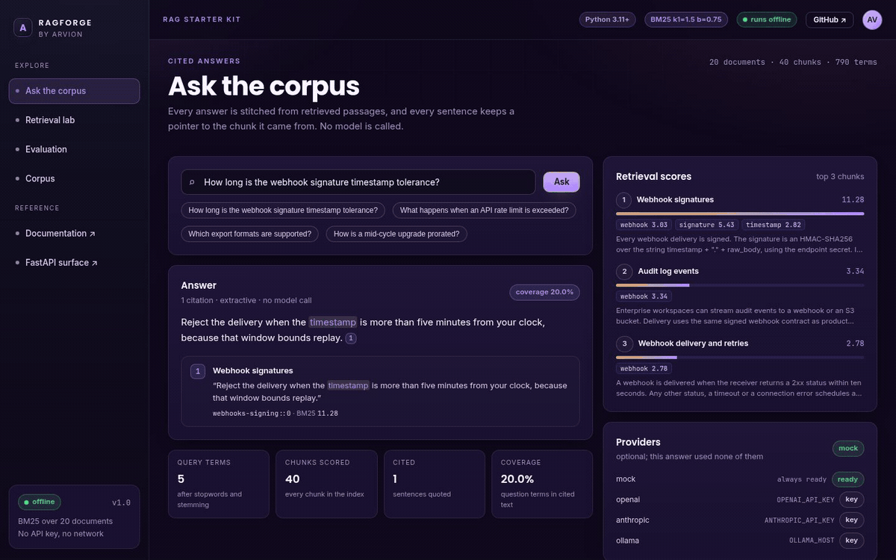
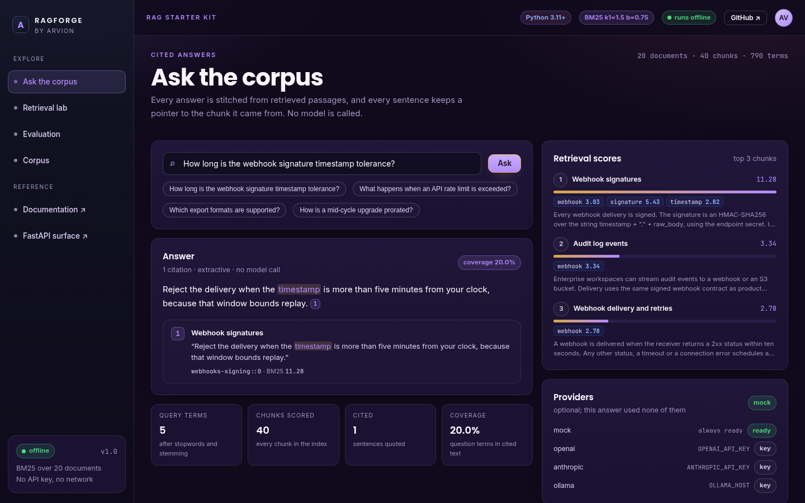
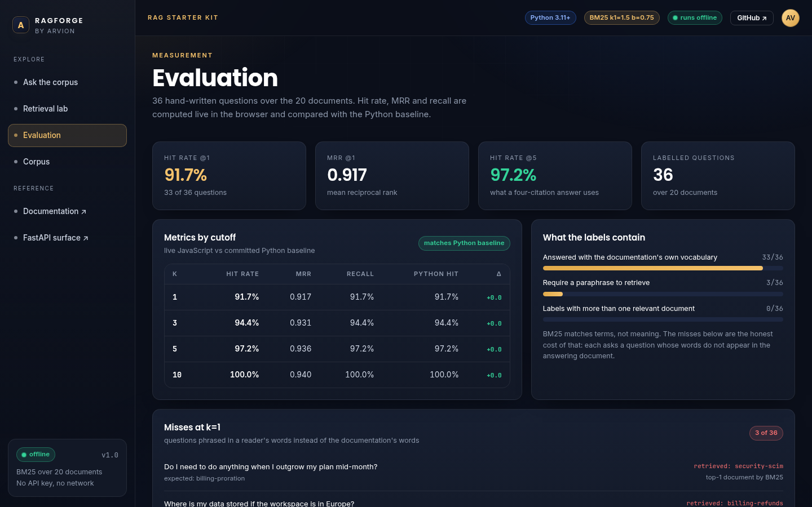

<div align="center">

</div>

<sub>Recorded from the live demo, <a href="docs/demo.mp4">MP4</a> · <a href="docs/screenshot.png">static frame</a></sub>

# RAGForge

A RAG starter kit that runs without an API key. It ingests documents, chunks
them, retrieves with Okapi BM25 and composes answers where every sentence points
at the chunk it came from. A small evaluation harness reports hit rate, MRR and
recall over 36 labelled questions, so a change to chunk size or tokenisation is
measured instead of guessed.

[**Live demo**](https://arvion-technology.github.io/labs/demos/ragforge/demo/) · [MIT](LICENSE) · Python 3.11+

---

Most RAG examples start with an OpenAI key, a vector database and a framework.
That is a fine production stack, but it makes the retrieval layer hard to see:
when an answer is wrong you cannot tell whether the chunker, the retriever or the
model is at fault. RAGForge keeps the deterministic half of the pipeline in plain
Python with no dependencies, and treats the model as an optional final step.
The included 20-document corpus is product documentation for a fictional API
platform, so every answer and every evaluation number in the demo comes from
code you can read.

## What it does

- **Ingest** Markdown, HTML, plain text or a JSON corpus into one document shape.
- **Chunk** with heading-aware packing, or fixed windows for unstructured text.
- **Retrieve** with BM25 over the chunk index and show the per-term score
  contribution for every hit.
- **Answer** extractively with numbered citations, or hand the cited passages to
  a provider when one is configured.
- **Evaluate** retrieval with hit rate, MRR and recall at several cutoffs, plus
  citation precision for composed answers.
- **Serve** the same retriever through a FastAPI app shape (`/health`, `/query`,
  `/query/stream`, `/ingest`, `/eval`) or a CLI.
- **Demo** the identical maths in the browser through a checked JavaScript port.

## Screenshots

| Cited answer and retrieval scores | Evaluation tab |
| --- | --- |
|  |  |

## Architecture

```
 corpus/documents.json ──┐
 corpus/eval.json ───────┤
                         ▼
  ragforge/ingest.py   load + normalise documents
         │
         ▼
  ragforge/text.py     tokenise, stopwords, plural stemming
         │
         ▼
  ragforge/chunk.py    heading-aware packing (120 tokens, 30 overlap)
         │
         ▼
  ragforge/bm25.py     index, idf, per-term scoring, document roll-up
         │
         ├──► ragforge/answer.py     extractive, numbered citations
         ├──► ragforge/evaluate.py   hit rate, MRR, recall, citation precision
         └──► ragforge/providers.py  optional prose rewrite (mock/openai/anthropic/ollama)

 demo/  ──► src/retrieval.js   JavaScript port of text+chunk+bm25+answer
                             checked against test/fixtures/bm25-parity.json
```

The demo does not reimplement retrieval for display: it imports `src/retrieval.js`,
which is a line-for-line port of the Python modules. Both sides are tested against
the same committed fixture, so the browser cannot drift away from the CLI.

## Quickstart

```bash
git clone https://github.com/arvion-technology/ragforge.git
cd ragforge

python3 -m venv .venv && source .venv/bin/activate
pip install -e ".[dev]"

python -m unittest discover -s tests -v    # 103 tests, standard library only
node --test test/                          # 10 tests for the JavaScript port
python -m ragforge stats
python -m ragforge ask "How long is the webhook signature tolerance?"
```

There is no server to start for the demo:

```bash
python3 -m http.server 4173     # open http://localhost:4173/demo/
```

The HTTP API needs FastAPI, which is optional:

```bash
pip install fastapi uvicorn
python -m ragforge serve --port 8000
curl -s localhost:8000/query -H 'content-type: application/json' \
  -d '{"question":"Which export formats are supported?","k":4}'
```

## How it works

### BM25, and why the heading is counted twice

The index is an inverted list of stemmed terms per chunk. Scoring is the standard
Okapi formula with `k1=1.5` and `b=0.75`:

```
idf(t)  = ln(1 + (N - df(t) + 0.5) / (df(t) + 0.5))
score   = Σ idf(t) · tf·(k1+1) / (tf + k1·(1 - b + b·len/avgdl))
```

Headings are included in the chunk's term frequency twice, and the body once.
A heading is a human-written topic label; a section called "Rate limits" should
outrank another document that mentions the phrase once in passing. This is still
plain BM25, the heading just contributes term occurrences, so there is no second
scoring system to reason about. Document-level ranking takes the best-scoring
chunk per document, because evaluation labels point at documents, not chunks.

### Chunking keeps sections intact

Documents are split on `##` headings first. Whole sections are packed into a
window of 120 tokens with up to 30 tokens of trailing overlap; a section is only
sentence-windowed when it does not fit on its own. This is deliberate: in the
demo corpus the answer to "How long is the webhook signature timestamp
tolerance?" sits in the second section of the webhooks document, and a naive
fixed-size splitter separated it from the heading that makes it retrievable.
`tests/test_chunk.py` covers section packing, overlap, the oversized-section
fallback and chunk-id stability.

### Answers are quoted, not generated

`compose_answer` takes the retrieved chunks, picks the sentence in each chunk
with the most query-term overlap, and numbers them. Two small heuristics matter:

- **Question shape.** "How long" and "how many" questions get a bonus for
  sentences containing a number and a unit, so the answer quotes "within five
  minutes" rather than "every delivery is signed".
- **Relative score floor.** Chunks scoring below 40% of the top hit are dropped
  rather than padded into the citation list. One correct citation is better than
  three where two are noise.

If nothing matches, the answer is an explicit refusal. A RAG demo that always
answers is hiding its failure mode.

### Evaluation is part of the product

`corpus/eval.json` holds 36 questions written while reading each document. The
committed baseline (measured, not estimated):

| cutoff | hit rate | MRR | recall |
| --- | --- | --- | --- |
| k=1 | 91.7% | 0.917 | 91.7% |
| k=3 | 94.4% | 0.931 | 94.4% |
| k=5 | 97.2% | 0.936 | 97.2% |
| k=10 | 100% | 0.940 | 100% |

The 3 misses at k=1 are questions whose wording does not appear in the
documentation, "Can I get my money back after the first month?" instead of
"refund". That gap is the honest argument for adding embeddings later; it is
not a bug in the tokeniser, and tuning the labels until the score is 100% would
have hidden it. The demo shows the misses by name.

## Using the library

```python
from ragforge import Retriever, evaluate, load_eval_labels

retriever = Retriever.from_corpus_file("corpus/documents.json")
answer = retriever.ask("How are webhook signatures verified?", k=4)

print(answer["answer"])
for citation in answer["citations"]:
    print(citation["marker"], citation["doc_id"], citation["score"])

report = evaluate(retriever, load_eval_labels(), k=5)
print(report["hit_rate"], report["mrr"])
```

`Retriever` accepts `size`, `overlap`, `strategy` (`heading` or `fixed`), `k1` and
`b`, so the effect of those knobs is one argument away from the evaluation
harness. `pip install .` does not ship the demo corpus; point
`Retriever.from_corpus_file()` at your own directory of Markdown or HTML instead.

## Tests

```bash
python -m unittest discover -s tests -v
node --test test/
```

103 Python tests cover tokenisation, sentence splitting, section packing,
oversized-section fallback, BM25 ranking and attribution, answer composition and
refusals, evaluation maths, ingestion of all four formats, provider configuration
(zero network calls), the full retriever, and the parity fixture. The 10 Node
tests check the JavaScript port against the same fixture, plus answer rendering
rules and that live evaluation matches the committed Python baseline.

Two small scripts keep the fixtures honest:

```bash
python3 tools/export_fixture.py    # test/fixtures/bm25-parity.json
python3 tools/export_baseline.py   # corpus/baseline.json
```

## Limitations

- **No PDF ingestion.** PDFs need a text extractor, which would add a dependency
  and an OCR path. The loader covers Markdown, HTML, plain text and JSON.
- **No embeddings.** Retrieval is lexical. Paraphrased questions lose; the
  evaluation tab quantifies how often.
- **No vector store.** The index is in memory and rebuilt on start. It is fine
  for thousands of chunks, not millions.
- **Provider adapters are untested against live APIs.** They are thin
  `urllib` wrappers with no retries or streaming. The mock provider is the one
  exercised by the test suite; the others are configuration-checked only.
- **The corpus is synthetic.** It is a fictional product's documentation, written
  for the demo. No customer documents are included.

## Project layout

```text
ragforge/
├── ragforge/               # Python package
│   ├── ingest.py           # Markdown/HTML/text/JSON loaders
│   ├── text.py             # tokeniser, stopwords, stemmer
│   ├── chunk.py            # heading-aware and fixed chunking
│   ├── bm25.py             # index and scoring with per-term attribution
│   ├── answer.py           # extractive cited answers
│   ├── evaluate.py         # hit rate, MRR, recall, citation precision
│   ├── providers.py        # optional generation adapters
│   ├── retriever.py        # the object most callers use
│   ├── api.py              # FastAPI app shape
│   └── cli.py              # python -m ragforge
├── src/retrieval.js        # checked JavaScript port used by the demo
├── corpus/                 # 20 documents, 36 labels, Python baseline
├── tests/                  # 103 unittest cases
├── test/                   # 10 node:test cases + parity fixture
├── demo/                   # static app; imports ../src/retrieval.js
├── tools/                  # fixture and baseline generators
└── docs/                   # screenshots
```

## Credits

Built by [Arvion Technologies](https://arviontech.net) in Kathmandu as part of our
open-source [Labs](https://github.com/arvion-technology/labs) series. If you need
retrieval over your own documents and want the evaluation to be part of the
delivery, this is the shape we start from.

MIT licensed.
